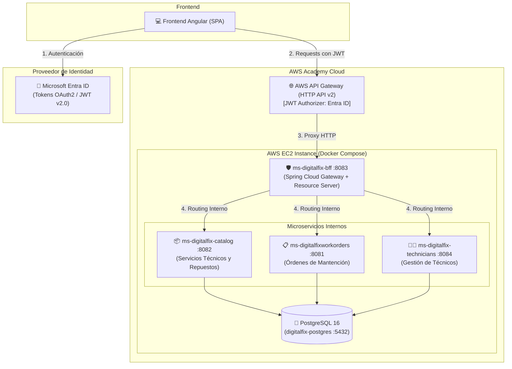

# 🔧 DigitalFix - Backend Microservices Platform

[](https://spring.io/projects/spring-boot)
[](https://openjdk.org/)
[](https://www.postgresql.org/)
[](https://www.docker.com/)
[](https://aws.amazon.com/)
[](https://www.microsoft.com/security/business/identity-access/microsoft-entra-id)

Plataforma backend distribuida basada en arquitectura de **microservicios**, desarrollada con **Java** y **Spring Boot**. DigitalFix centraliza la gestión de solicitudes de soporte técnico, asignación y seguimiento de órdenes de mantención en terreno, inventario de repuestos y administración del catálogo de servicios técnicos.

---

## 👨‍🏫 Guía Rápida para el Evaluador / Docente

Para evaluar este proyecto de forma inmediata en su máquina local, solo requiere **Docker** y **Git**:

### 1. Clonar y Levantar en 1 Comando
```bash
git clone https://github.com/Fabian-Armijo/backend-digitalfix.git
cd backend-digitalfix
docker compose up -d --build
```

### 2. Verificar que los Servicios Están Activos
```bash
docker compose ps
```
> Todos los contenedores deben aparecer con estado `Up` o `Up (healthy)`.

### 3. Puertos Expuestos para Evaluación
| Servicio | Contenedor | Puerto Local | Función Principal |
| :--- | :--- | :--- | :--- |
| **BFF / Gateway** | `ms-digitalfix-bff` | `8083` | Puerta de enlace segura con OAuth2/JWT |
| **Catálogo & Repuestos** | `ms-digitalfix-catalog` | `8082` | CRUD de Servicios Técnicos y Repuestos |
| **Órdenes de Mantención**| `ms-digitalfixworkorders` | `8081` | Ciclo de vida y transición de órdenes |
| **Gestión de Técnicos** | `ms-digitalfix-technicians`| `8084` | Registro y disponibilidad de personal técnico |
| **Base de Datos** | `digitalfix-postgres` | `5432` | PostgreSQL 16 (BD Relacional central) |

---

## 🏛️ Arquitectura del Sistema

La solución implementa el patrón **BFF (Backend For Frontend)** junto con un **API Gateway de entrada en AWS** y autenticación federada basada en tokens JWT con **Microsoft Entra ID (Azure AD)**.



---

## 👥 Matriz de Roles y Responsabilidades (RBAC)

El control de acceso basado en roles se valida en el BFF mediante la extracción de claims del token JWT emitido por Microsoft Entra ID (`ROLE_ADMIN`, `ROLE_SUPERVISOR`, `ROLE_CLIENTE`).

| Rol | Responsabilidades en la Evaluación | Permisos en API |
| :--- | :--- | :--- |
| **`ADMIN`** | Administra servicios técnicos, inventario de repuestos y supervisa KPIs operacionales. | CRUD total en `/api/catalog/**`, lectura/borrado de órdenes, gestión de técnicos. |
| **`SUPERVISOR`** | Acepta órdenes, asigna técnicos a mantenciones, gestiona transiciones de estado y descuenta stock. | Asignación y estados en `/api/workorders/**`, técnicos en `/api/technicians/**`, descuento de repuestos. |
| **`CLIENTE`** | Crea solicitudes de mantención y realiza seguimiento de sus órdenes en tiempo real. | Creación (`POST`) y consulta (`GET`) de órdenes de trabajo en `/api/workorders`. |

---

## 🧪 Comandos cURL para Pruebas Inmediatas

Para evaluar la funcionalidad de cada microservicio directamente desde la terminal (sin necesidad de loguearse en Microsoft), puede ejecutar las siguientes peticiones contra los puertos locales:

### 1. Pruebas de Catálogo y Repuestos (Puerto 8082)

```bash
# A. Crear un nuevo servicio técnico (Rol Admin)
curl -X POST http://localhost:8082/api/catalog/services \
  -H "Content-Type: application/json" \
  -d '{"name": "Mantenimiento Preventivo de Notebook", "fee": 35000, "description": "Limpieza y cambio de pasta térmica"}'

# B. Listar los servicios disponibles
curl http://localhost:8082/api/catalog/services

# C. Registrar un nuevo repuesto en inventario
curl -X POST http://localhost:8082/api/catalog/spare-parts \
  -H "Content-Type: application/json" \
  -d '{"name": "SSD NVMe 1TB Kingston", "cost": 65000, "stock": 10}'

# D. Descontar stock de un repuesto (Rol Supervisor)
curl -X PATCH http://localhost:8082/api/catalog/spare-parts/1/reduce-stock
```

---

### 2. Pruebas de Órdenes de Trabajo y Ciclo de Vida (Puerto 8081)

```bash
# A. Crear una solicitud de mantención (Rol Cliente #1)
curl -X POST http://localhost:8081/api/workorders \
  -H "Content-Type: application/json" \
  -d '{"customerId": 1, "description": "Laptop Asus no da video tras corte de energía"}'

# B. Crear una solicitud de mantención (Rol Cliente #2)
curl -X POST http://localhost:8081/api/workorders \
  -H "Content-Type: application/json" \
  -d '{"customerId": 2, "description": "PC de escritorio recalienta y se apaga a los 10 minutos"}'

# C. Listar todas las órdenes registradas
curl http://localhost:8081/api/workorders

# D. Asignar técnico #1 a la orden #1 (Rol Supervisor - pasa a ASIGNADA)
curl -X PATCH http://localhost:8081/api/workorders/1/assign/1

# E. Técnico en desplazamiento al domicilio (pasa a EN_DESPLAZAMIENTO)
curl -X PATCH "http://localhost:8081/api/workorders/1/status?newStatus=EN_DESPLAZAMIENTO"

# F. Iniciar mantención en terreno (pasa a EN_EJECUCION)
curl -X PATCH "http://localhost:8081/api/workorders/1/status?newStatus=EN_EJECUCION"

# G. Finalizar y cerrar orden con éxito (pasa a CERRADA)
curl -X PATCH "http://localhost:8081/api/workorders/1/status?newStatus=CERRADA"
```

---

### 3. Pruebas de Personal Técnico (Puerto 8084)

```bash
# A. Registrar un nuevo técnico
curl -X POST http://localhost:8084/api/technicians \
  -H "Content-Type: application/json" \
  -d '{"firstName": "Rodrigo", "lastName": "Morales", "email": "rodrigo.m@digitalfix.com", "phone": "+56988776655", "specialty": "Microelectrónica", "status": "DISPONIBLE"}'

# B. Listar técnicos registrados
curl http://localhost:8084/api/technicians
```

---

### 4. Pruebas de Seguridad en el BFF Gateway (Puerto 8083)

```bash
# Intentar acceder al BFF sin Token JWT (Debe responder 401 Unauthorized)
curl -i http://localhost:8083/api/catalog/services
```
> El BFF intercepta y rechaza la petición si no incluye el header `Authorization: Bearer <TOKEN>` emitido por Microsoft Entra ID.

---


## ☁️ Despliegue en Producción (AWS Academy Cloud)

El sistema se encuentra desplegado y operativo en la infraestructura cloud de **AWS Academy**:

* **AWS API Gateway (HTTP API v2):**  
  `https://y9alroweth.execute-api.us-east-1.amazonaws.com`
  * Valida tokens JWT con el Authorizer de Microsoft Entra ID.
  * Gestiona políticas de CORS para el cliente web Angular.
  * Enruta el tráfico por proxy inverso seguro hacia la instancia EC2.
* **Instancia AWS EC2 (Ubuntu Linux):**
  * Ejecuta Docker Engine con los 5 contenedores en red interna aislada (`digitalfix-network`).
  * Los contenedores cuentan con la directiva `restart: unless-stopped` para tolerancia a reinicios del servidor.
* **Pipeline CI/CD (GitHub Actions):**
  * Ubicado en `.github/workflows/deploy.yml`.
  * Despliegue continuo automático a la EC2 en cada `git push origin main`.
  * Soporte para ejecución manual vía `workflow_dispatch`.

---

## 🛠️ Comandos Útiles para el Evaluador

```bash
# Ver logs en vivo de todos los servicios
docker compose logs -f

# Ver logs únicamente del BFF
docker compose logs -f bff-service

# Detener los contenedores conservando los datos de la BD
docker compose down

# Reiniciar la base de datos limpia desde cero
docker compose down -v && docker compose up -d --build
```
